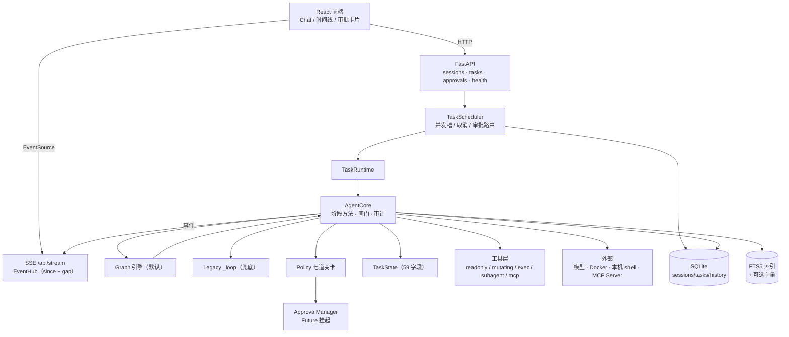
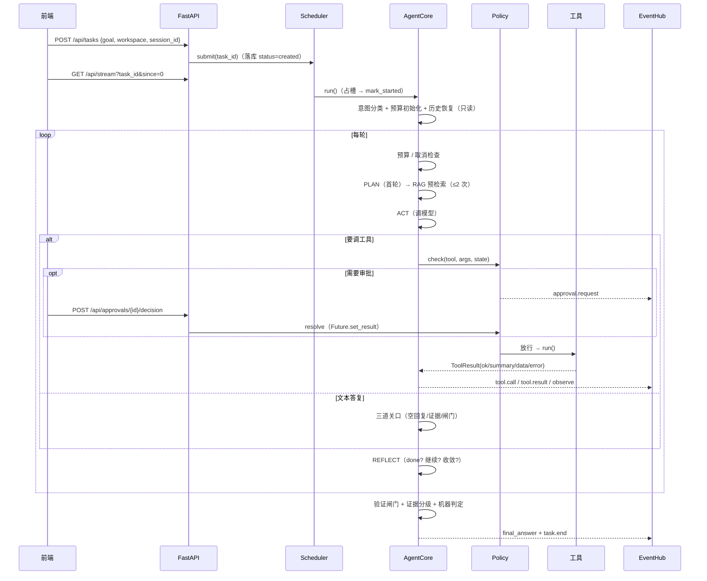
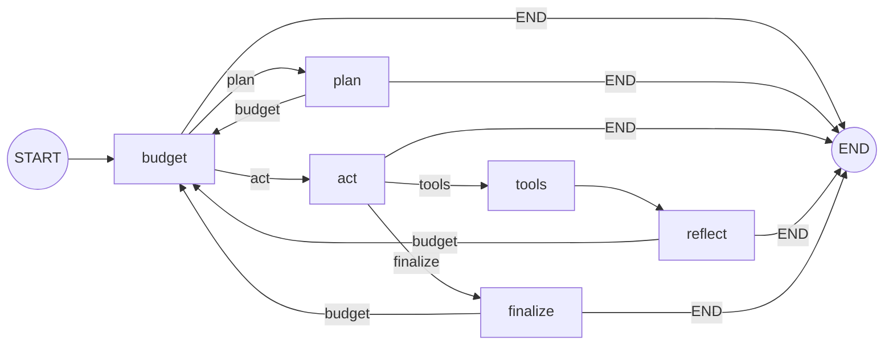

# Loom Agent

**一个跑在自己电脑上的 Coding Agent 运行时。**
给它一句话，它会规划、查项目、调工具、改文件、跑命令、验证结果，最后给一份**带证据**的答案。

- 默认执行引擎 **Graph**（LangGraph），**Legacy** 保留为显式兜底
- **1308** 项离线自检 · **19** 种事件 · **6** 个内置工具 + 可选 RAG / MCP / 子任务
- 离线优先、审批前置：没有 API Key 也能跑演示，没有网络也不影响核心逻辑

> 这是**学习型项目**，不是产品：架构清晰 > 功能数量，可理解性 > 代码量。
> 所以代码里有大量"为什么这么写、踩过什么坑"的注释，也有明确写着"这个不做"的边界。

---

## 目录

- [1. 这是什么](#1-这是什么)
- [2. 现在能做什么](#2-现在能做什么)
- [3. 快速开始](#3-快速开始)
- [4. 架构](#4-架构)
- [5. 一个任务的一生](#5-一个任务的一生)
- [6. 核心机制](#6-核心机制)
- [7. 工具与安全](#7-工具与安全)
- [8. 检索：BM25 + 本地向量](#8-检索bm25--本地向量)
- [9. 外部工具：MCP](#9-外部工具mcp)
- [10. 父子任务](#10-父子任务)
- [11. 数据与持久化](#11-数据与持久化)
- [12. 前端](#12-前端)
- [13. 测试](#13-测试)
- [14. 配置](#14-配置)
- [15. 已知限制](#15-已知限制)
- [16. 路线图](#16-路线图)
- [17. 目录结构](#17-目录结构)
- [18. 文档索引](#18-文档索引)

---

## 1. 这是什么

Loom 把"一次提问"变成"一次任务"：有状态、可中断、可审批、可审计、可回放。

| 维度 | 普通 Chatbot / 单轮 API | Loom |
|---|---|---|
| 输入 | 一句话 | 一句话 → 任务（可取消、可被审批阻塞） |
| 输出 | 一段文本 | 一段**有证据**的文本 + 完整执行轨迹 |
| 过程 | 无 | PLAN → ACT → TOOLS → REFLECT → FINAL，多轮自纠正 |
| 副作用 | 无 | 读/写工作区、Docker 沙箱命令、宿主机终端、MCP 工具 |
| 安全 | 无 | Policy 七道关卡 + 人工审批 + 预算熔断 + 验证闸门 |
| 可观测 | 无 | 19 种事件经 SSE 推到时间线，可按 `task_id` 回放 |
| 失败语义 | 编一段话 | 终态 + 原因码 + 证据等级，**绝不伪造成功** |

一句话区分它和普通 Chatbot 的地方：**"说完成"不算完成，要过验证闸门**。

---

## 2. 现在能做什么

| 能力 | 状态 | 说明 |
|---|---|---|
| 多轮 Agent 执行 | ✅ | Graph 默认；Legacy 显式兜底 |
| 文件读 / 列目录 | ✅ | 40k 字符截断、多编码、行号、hash |
| 文件写 / 局部改 | ✅ | 覆盖前备份、唯一匹配、`expect_hash` 防 stale |
| Docker 沙箱命令 | ✅ | 断网 / 只读根 / 非 root / 限额，无宿主机分支 |
| **宿主机终端** | ✅ | pwsh / Windows PS / CMD / Git Bash；**无沙箱**，靠审批 + cwd + 超时 |
| Policy + 人工审批 | ✅ | 七道关卡；`asyncio.Future` 真挂起，超时=拒绝 |
| 预算 / 熔断 / 取消 | ✅ | 轮次·秒·工具数·重复·错误；取消在下一轮检查点生效 |
| 验证闸门 + 证据分级 | ✅ | A/B/C 分级 + "零改动不得报 done" |
| 项目知识检索 | ✅ | FTS5 + bm25；**可选**本地向量 + RRF 融合 |
| MCP 工具接入 | ✅ | 仅本地 stdio；默认要审批；无自动重连 |
| 父子任务 | 🟡 | 串行派生、结果信封、层级/数量/预算上限 |
| 事件 + SSE 时间线 | ✅ | 19 种事件，`since` 补拉 + `stream.gap` 快照恢复 |
| 任务持久化 | ✅ | SQLite：sessions / tasks / task_history |
| 跨进程恢复 | ❌ | 无 checkpoint，重启不能续跑 |
| 并行子任务 / 子任务树 | ❌ | 首版串行；前端树属于 M6 |
| 桌面应用（Tauri） | ❌ | 只有 `.bat` 启动器 |
| 向量检索 | 🟡 | 已实现，默认关（`LOOM_RAG_EMBED=off`） |
| `delete_file` | ❌ | 从未实现 |

---

## 3. 快速开始

### 3.1 先看它跑（不需要 API Key）

```bash
git clone https://github.com/Lucas-1u/loom-agent.git
cd loom-agent

python -m venv .venv
.venv/Scripts/pip install -r requirements.txt      # Windows
# source .venv/bin/activate && pip install -r requirements.txt   # macOS / Linux

python -m backend.demo            # 正常：规划 → 观测 → 写文件（含审批）
python -m backend.demo --reject   # 拒绝：写操作被拒后如何收场
python -m backend.demo --budget   # 熔断：重复调用 + 轮数耗尽
```

`demo` 会自建临时工作区、跑完整套 Agent Loop，打印**调试面板**（轮次/证据/审批/文件变更/计划打勾）、
**事件直方图**、**磁盘实际状态**。理解机制最快的入口。

### 3.2 接真实模型（CLI）

```bash
cp .env.example .env
# 填 BAILIAN_API_KEY / DEEPSEEK_API_KEY / XFYUN_API_KEY 之一
python -m backend.cli -w D:/some/project "分析这个项目的结构"
```

三家都走 OpenAI 兼容协议，同一个 Adapter（`backend/models/openai_compat.py`），换供应商只改配置。

常用参数：`-m bailian|deepseek|xfyun`、`--model-name`、`--readonly`、`--no-plan` / `--no-reflect`、
`--yes` / `--no`（自动批准/拒绝）、`--dry-run`。交互模式里 `:t` 看工具、`:s` 看预算、`:q` 退出。

### 3.3 起服务 + GUI

```bash
python -m backend.server                      # 默认 127.0.0.1:8765
cd frontend && npm install && npm run dev     # http://localhost:5173
```

前端**真的在跟后端说话**：会话/任务来自 `GET /api/sessions`、`POST /api/tasks`，
执行过程走 `GET /api/stream`（SSE，断线用 `?since=<lastId>` 补拉），
审批走 `POST /api/approvals/{id}/decision`，取消走 `POST /api/tasks/{id}/cancel`。
演示数据只在后端不可达时兜底（右上角显示 `DEMO` / `OFFLINE`，不假装连上）。

### 3.4 Windows 一键启动

`loom.bat`（CLI）与 `loom-gui.bat`（GUI）：切到项目根、清代理、用 `.venv`、清掉 `PYTHONUTF8` ——
四件事少做一件就会报错。GUI 版还会查端口、起 Vite、自动开浏览器。
装到桌面：`python dev/install_desktop.py`。

### 3.5 Docker 沙箱（`run_command` 用）

```bash
docker build -f dev/Dockerfile.sandbox -t loom-sandbox:py312 .
```

镜像只需 build 一次；运行期 `--network none` + `--pull never`，**不会联网拉依赖**。
Docker 不可用时 `run_command` 直接返回 `sandbox_unavailable`——**不降级到宿主机**。
需要本机环境时用 `terminal`（另一个工具，见 §7）。

---

## 4. 架构



**依赖方向单向**：`server/ → agent/ → tools/`，**`agent/` 禁止 import `server/`**
（所以 RAG 自带 SQLite 连接，不复用 server 的库句柄）。

| 层 | 关键文件 | 职责 |
|---|---|---|
| 入口 | `server/app.py` `scheduler.py` `runtime.py` | HTTP/SSE、并发调度、单任务执行器 |
| 内核 | `agent/core.py` | 阶段方法、闸门、审计、RAG 接入、子任务入口 |
| 编排 | `agent/graph_engine.py` | LangGraph 图；节点调 core 的阶段方法 |
| 状态 | `agent/state.py` | `TaskState`（唯一真相）、`TaskStatus`、`RiskLevel`、`PlanStep` |
| 策略 | `agent/policy.py` `agent/approval.py` | 七道关卡、审批挂起/恢复 |
| 工具 | `tools/base.py` `registry.py` `tools/*` | 工具抽象、注册表、具体工具 |
| 检索 | `agent/rag/*` | 索引 / 检索 / 融合 / 嵌入 |
| 外部 | `mcp/*` `sandbox/manager.py` `models/openai_compat.py` | MCP 客户端、Docker 沙箱、模型适配 |

---

## 5. 一个任务的一生



关键落点：

| 步骤 | 位置 |
|---|---|
| 建任务 / 落库 | `server/app.py` → `store.create_task` |
| 引擎选择 | `AgentCore.run`：`config.orchestrator`（默认 `graph`） |
| 上下文构造 | `agent/context.py` + `prompts/system.py`（阶段提示） |
| 模型调用 | `AgentCore._call_model` → `OpenAICompatAdapter` |
| 工具执行 | `AgentCore._execute_tools` → `Policy.check` → `tools/registry.execute` |
| 收尾 | `_finalize_text_reply` / `_final_phase` → `state.finish` |
| 落终态 | `store.save_task`（写 `state_json`）+ `task_history` |

---

## 6. 核心机制

### 6.1 阶段与方法

`AgentCore` 是唯一执行内核，两条引擎调同一组方法：

| 阶段 | 方法 | 产出 |
|---|---|---|
| 预算 | `_budget_verdict` | 续期 / 终结（`budget_turns`、`budget_seconds`、`cancelled`…） |
| 计划 | `_plan_phase` | `PlanStep[]`（≤8 步，带完成条件类型） |
| 行动 | `_act_phase` | `ModelReply`（文本或 tool_calls） |
| 工具 | `_execute_tools` | `tool_events` / `change_records` / `command_history` |
| 反思 | `_reflect_phase` | done / continue / 收敛（`no_progress`） |
| 收尾 | `_finalize_text_reply` / `_final_phase` | 最终答复 + 终态 |

### 6.2 Graph 是默认引擎



- 默认 `graph`；`LOOM_ORCHESTRATOR=legacy` 显式切回（**暂不删除**）。
- 图状态只放路由信息（`phase/route/note/turns`），**任务真相始终在 `TaskState`**。
- 每个条件边的 `path_map` **必须显式包含 `END`**：LangGraph 会静默丢弃未声明的目标。
  这条坑曾让 `plan` 节点返回的 END 被吞掉，模型认证失败时任务空转到轮次耗尽。
- **没有 checkpointer，没有 interrupt/resume**：图异常直接 `failed`，绝不回退 legacy 重跑
  （工具副作用可能已经发生）。

### 6.3 Policy：七道关卡

`agent/policy.py::Policy.check`，按顺序：

| # | 关卡 | 拦什么 |
|---|---|---|
| ① | 工具存在 / 白名单 | 未注册、`allowed_tools` 之外 |
| ② | 参数 JSON | 模型给了坏 JSON |
| ③ | schema | 缺必填 / 类型错 |
| ④ | 预算 | 轮次/工具数/秒数耗尽 |
| ⑤ | 重复熔断（软） | 同参调用超限 |
| ⑤b | 确定性失败熔断（硬） | 撞过一次的确定性失败再撞 |
| ⑤b2 | 用户声明只读 | 一切写文件操作 |
| ⑤c | 禁止路径 | 用户显式 forbidden |
| ⑤d | 允许范围 | 范围外写入（执行前） |
| ⑥ | 审批 | `risk != read` → `require_approval` |
| ⑦ | 放行 | — |

风险来自三处：工具类属性、`tool.risk_for(args)`（按参数判定，`terminal` 的只读白名单用它）、
以及 MCP/子任务工具的配置。**模型不能给自己声明安全**。

### 6.4 审批是"真挂起"

`ApprovalManager.request()` 建 `asyncio.Future` → `await wait_for(fut, timeout)`。
**不是轮询**：任务真的停住，事件循环继续服务其他任务。
用户点批准 → `POST /api/approvals/{id}/decision` → `Future.set_result` →
`recheck_after_approval`（TOCTOU 防护）→ 工具才执行。
`args_hash` 防"批准后换参数"、`pop` 防重放。超时 = 拒绝；**跨进程不支持**。

### 6.5 预算、取消、闸门

- 预算：`max_turns=20`、`max_seconds=300`、`max_tool_calls=40`、`max_same_call_repeat=3`、`max_errors=5`；
  轮次可**有界续期**一次（出现循环/停滞/冲突则不续）。
- 取消：`scheduler.cancel` → `cancel_event` → 下一轮检查点生效；工具层各自尽力终止
  （容器 stop / `taskkill /T` / 子任务 cancel）。
- 验证闸门 `_verification_gate`：意图 → 最后命令 → 证据 A/B/C → 风险收尾；
  `repair` 且零改动零命令 → 直接判未通过。收尾时 `answer` 附**机器判定段**（非模型自述）。

### 6.6 事件与 SSE

- 19 种事件：`task.start/end`、`plan`、`thinking`、`act`、`observe`、`tool.call/result`、
  `approval.request/decision/expired`、`reflect`、`final_answer`、`error`、`budget.exceeded`、
  `context.compacted`、`rag.retrieve/result`、`state.snapshot`。
- `EventBus.emit` 同步分配全局 `seq`；`EventHub` 缓冲（3000 条 / 单条 64KB），
  订阅者队列满 → 丢最旧 + 标 `need_gap` → 前端收到 `stream.gap` 后走快照恢复。
- **事件不落盘**；`task_history` 存的是消息级历史（append-only）。
- 前端 `EVENT_TYPES` 少一项 → 该事件的 SSE 帧会被浏览器**静默丢弃**；
  靠 `npm run test:events` 双向比对兜底（构建期）。

---

## 7. 工具与安全

### 7.1 工具清单

| 工具 | 风险 | 审批 | 副作用 | 说明 |
|---|---|---|---|---|
| `list_files` | read | 否 | 无 | 列目录，跳过噪音目录 |
| `read_file` | read | 否 | 无 | 40k 字符、多编码、行号、hash |
| `search_docs` | read | 否 | 无 | 项目检索（`mode`: keyword/semantic/hybrid）；**仅在启用 RAG 时注册** |
| `write_file` | write | **是** | 改文件 | 覆盖前备份 |
| `edit_file` | write | **是** | 改文件 | 唯一匹配 / stale 检测 / 备份 |
| `run_command` | exec | **是** | 执行 | **Docker 沙箱**，无宿主机分支 |
| `terminal` | exec | **是**（只读白名单免） | 执行 | **宿主机** shell；cwd 必须在工作区 |
| `spawn_subtask` | write | **是** | 建任务 | 派生子任务并等待；拒绝则不创建 |
| `mcp__<server>__<tool>` | 默认 write | **是** | 由 Server 决定 | 外部 MCP 工具 |

> 不注入 `knowledge` / `mcp` / `spawner` 时，对应工具**不会注册**——离线演示与旧测试行为不变。

### 7.2 三条硬边界

1. **工作区**：`path_safety` 做 realpath + 前缀校验，`..` 与工作区外绝对路径一律拒；
   `run_command` 把工作区挂进容器（`:rw`），容器看不到别处；`terminal` 的 `cwd` 同样受限。
2. **审批**：写/执行类工具默认都要人工批准；MCP 工具默认不信任；模型不能给自己降级。
3. **凭据**：`terminal` 不把名字像 KEY/TOKEN/SECRET 的环境变量传给子进程，
   输出里出现这些值会替换成 `***` 并计数。

**提示词 vs 硬约束**：工作区越界、审批、沙箱、只读声明都是**后端强制**；
"资料不是指令""不要修改 tests/"是提示 + 闸门（软），后者还能靠 `forbidden_paths` 变硬。

---

## 8. 检索：BM25 + 本地向量

**默认纯关键词**（`LOOM_RAG_EMBED=off`）：SQLite FTS5 + bm25，中文先切 bigram 再入库。
打开向量后变成混合检索。

| mode | 含义 |
|---|---|
| `keyword` | 只用 FTS5 + bm25 |
| `semantic` | 只用向量余弦（本地 fastembed / ONNX） |
| `hybrid` | 两路各取候选 → **RRF** 融合（`Σ 1/(60+rank)`，只看名次） |
| `auto` | 用服务端默认（`LOOM_RAG_MODE`，默认 hybrid） |

- 命中带 `matched_by`（`bm25` / `vector` / `both`），能看出"这条靠词面还是语义进来的"。
- 向量不可用（没装 fastembed / 模型没下 / 编码失败）→ **降级成 keyword** 并在结果与事件里标
  `degraded`（如 `no_embedder:off`），**不会**静默返回空。
- 索引增量：只给新增/改动的片段算向量；按 `model` 字段隔离，换模型不会串味。
- 自动检索**每任务最多 2 次**（任务开始 + 计划出来后），中途靠模型调 `search_docs`；
  三层计数分开记：`count`（命中）≠ `injected`（注入）≠ `rag_used`（被后续引用）。
- 资料是**不可信数据**：不参与风险判定、不能绕过审批、不能覆盖系统规则。

```bash
# 打开向量（模型缓存在 sandbox/models，约 90MB，已 gitignore）
LOOM_RAG_EMBED=onnx
LOOM_RAG_MODE=hybrid
```

---

## 9. 外部工具：MCP

第一版只支持**本地 stdio** Server（官方 SDK `mcp`，实测 2.3.0）。

```json
{"servers":[{"id":"notes","command":"...python.exe","args":["-B","server.py"],
             "env":{"MCP_TEST_DIR":"..."},"enabled":true,"trust":"prompt",
             "read_tools":["read_note"]}]}
```

- 开启：`LOOM_MCP=1` + `LOOM_MCP_CONFIG=<json>`（默认关，示例见 `mcp_servers.example.json`）。
- 生命周期：**服务启动时**连接并发现工具；每个 Server 一个常驻 task 持有 SDK 异步上下文
  （anyio 要求 `__aenter__/__aexit__` 同 task）；退出统一 `close()`。
- 安全：**默认 `risk=write`（必须审批）**；只有配置 `trust:"read"` 或 `read_tools` 才按只读；
  Server 的 description/schema **不参与**风险判定；子进程 env 走白名单，主进程凭据不给。
- 命名 `mcp__<server>__<tool>`，来源用 `source={kind,server,tool}` 元数据（不靠解析名字）。
- 超时/断开 → 该 Server 标记 `failed`，**不自动重连、不自动重试**。

---

## 10. 父子任务

`spawn_subtask` 让父 Agent 把一件可独立验收的事派给子任务，并**等它结束**（首版串行）。

| 边界 | 默认值 |
|---|---|
| 派生层级 | 2 |
| 每父任务子任务数 | 3 |
| 子任务预算 | 8 轮 / 180s / 12 次工具 |
| 单次派生总超时 | 240s |
| 审批 | 派生本身要审批；拒绝 → 子任务**根本不创建** |

- `tasks.parent_task_id`（schema v2，`ALTER` 迁移）；根任务为 NULL。
- 子任务**共用父任务的 ToolRegistry / Policy / 审批 / 闸门**，没有旁路；引擎与工作区约束继承。
- 结果信封：`task_id / status / end_reason / summary / evidence / tools / commands / changes`；
  子任务非 `done` → 工具返回失败，**不伪装成功**。
- 子任务默认不开 PLAN/REFLECT（父已拆解，省轮次给工具与验证）。

---

## 11. 数据与持久化

| 实体 | 存储 | 说明 |
|---|---|---|
| Session | `sessions` 表 | 会话容器，1:N 任务 |
| Task | `tasks` 表（含 `state_json`、`parent_task_id`） | 一次任务的状态与结果 |
| 消息历史 | `task_history`（append-only，`(task_id, seq)` 幂等） | 刷新后能看历史 |
| 事件 | **内存**（EventHub，3000 条上限） | 不落盘；断线靠 `since` + 快照 |
| 审批 | 内存（`asyncio.Future`） | 进程退出即失效 |
| 知识索引 | 独立 SQLite（`sandbox/index/knowledge.db`） | 按 workspace 隔离；可含向量 |

**重启能恢复什么**：任务列表 / 快照 / 结果 / 历史消息 ✅；
**继续跑中断的任务** ❌（`safe_to_resume` 恒 False，无 checkpoint）；恢复挂起的审批 ❌。

---

## 12. 前端

React 19 + Vite 8 + TypeScript 6 + Tailwind 4，单一 `useReducer` store（`features/session/store.tsx`）。

- 三栏：左侧按**工作目录**分组的会话列表 / 中央双视图（聊天 · 执行流）/ 底部工作区与输入框。
- 事件时间线：`EventCard` 按事件类型分派渲染——工具调用（含 MCP 来源徽标）、终端的
  命令/exit/stdout/stderr、审批卡、RAG 检索命中、压缩事件等。
- 断线：自研指数退避重连（显式关掉浏览器原生重连），带 `since` 续传；`stream.gap` → 快照恢复。
- 模型下拉：显示 `/api/health` 的真实模型，其余候选 `disabled`（**只能看，不能切**）。

---

## 13. 测试

```bash
# 离线自检（不需要 API Key）—— 1308 项
python -m backend.selfcheck_p1        #  55  契约层：事件/错误码/schema
python -m backend.selfcheck_p2        #  45  模型层：候选轮换/错误分类
python -m backend.selfcheck_agent     # 597  Agent 全链路：阶段/闸门/预算/审批/压缩/意图
python -m backend.selfcheck_cli       #  67  CLI 渲染/审批/中文解码
python -m backend.selfcheck_server    # 185  存储/Hub/运行时/调度/恢复
python -m backend.selfcheck_sandbox   #  96  Docker 参数与控制流
python -m backend.selfcheck_rag       # 109  索引/检索/集成/安全/闭环/混合
python -m backend.selfcheck_mcp       #  63  MCP 连接/发现/注册/审批/超时/关闭
python -m backend.selfcheck_subtask   #  32  父子任务/迁移/上限/取消
python -m backend.selfcheck_terminal  #  59  终端探测/真跑/越界/审批/双引擎

# 集成 / 真实环境（按需）
python -m backend.server.test_live_e2e       #  51  真 HTTP/SSE/调度/审批（模型替身）
python -m backend.test_sandbox_docker        #  25  真实容器
python -m backend.test_live_model            #   7  真实模型 7 场景（要 Key）

cd frontend
npm run test:events    # 33  事件契约：后端 EventType ↔ 前端清单 ↔ 样式
npm run test:session   # 21  会话隔离 + 状态映射
npm run test:workspace # 26  路径规范化 / 分组
npx tsc -p tsconfig.app.json --noEmit
```

**最值钱的是"可证伪"断言**：删掉事件发射、把风险判定改成全都免审批、去掉派生上限、
把 `rag_context_block` 置空——都会立刻让测试变红。数量本身不重要，**能失败**才重要。

---

## 14. 配置

`.env`（示例见 `.env.example`），常用项：

| 变量 | 默认 | 说明 |
|---|---|---|
| `BAILIAN_API_KEY` / `DEEPSEEK_API_KEY` / `XFYUN_API_KEY` | — | 三家任选其一 |
| `LOOM_MODEL` | 供应商默认 | 模型名，如 `spark-x2.6`、`qwen3.7-plus` |
| `LOOM_ORCHESTRATOR` | `graph` | `graph` / `legacy` |
| `LOOM_MAX_TURNS` / `LOOM_MAX_SECONDS` / `LOOM_MAX_TOOL_CALLS` | 20 / 300 / 40 | 任务预算 |
| `LOOM_APPROVAL_TIMEOUT` | 180 | 审批等待上限（超时=拒绝） |
| `LOOM_RAG` / `LOOM_RAG_DB` | 1 / `sandbox/index/knowledge.db` | 检索开关与库路径 |
| `LOOM_RAG_EMBED` / `LOOM_RAG_MODE` | `off` / `hybrid` | 向量开关与默认检索方式 |
| `LOOM_MCP` / `LOOM_MCP_CONFIG` | 0 / — | MCP 开关与配置路径 |
| `LOOM_AGENTS` / `LOOM_AGENT_MAX_DEPTH` / `LOOM_AGENT_MAX_CHILDREN` | 1 / 2 / 3 | 子任务开关与上限 |
| `LOOM_TERMINAL` | 1 | 宿主机终端开关 |
| `LOOM_SANDBOX_IMAGE` | `loom-sandbox:py312` | 沙箱镜像 |

完整列表见 `.env.example`（按模块分组，含注释）。

---

## 15. 已知限制

- **没有跨进程恢复**：无 checkpointer，`safe_to_resume` 恒 False；重启只能看结果，不能续跑。
- **没有并行子任务**：`spawn_subtask` 是同步等待，多子任务线性累加时间。
- **`terminal` 没有沙箱**：命令以你的用户身份运行，安全靠审批 + cwd + 超时；
  审批卡里写明了这一点，不要把它当隔离环境。
- **MCP 只支持本地 stdio**：无远程传输、OAuth、自动重连；in-flight 调用无法取消。
- **检索以关键词为主**：向量是可选增强，没有 reranker；同义词/改述仍可能搜不到。
- **事件不落盘**：前端落后一个版本时，未知事件会被静默丢弃（构建期有契约测试兜底）。
- **CMD 的引号**：`python -c "print(1)"` 在 CMD 下会被拆坏，复杂引号用 PS 或脚本文件。
- **没有 Tauri 桌面壳**、**没有 `delete_file`**。

---

## 16. 路线图

| 阶段 | 状态 |
|---|---|
| M1 编排地基 / M2 LangGraph / M2.1 工具链 / M2.2 事件契约 | ✅ |
| M3 项目知识检索（FTS5） | ✅ |
| M4.1 MCP Client（stdio） | ✅ |
| M4.2 RAG 实用化（查询构建 / 计划后检索 / 来源追溯） | ✅ |
| M4.3 Graph 设为默认引擎 | ✅ |
| M5 父子任务（串行） | ✅ |
| M6 展示与对比 | 🟡 混合检索已完成；前端任务树 / 对比报告待做 |
| 并行子任务调度 | ⬜ |
| Tauri 桌面外壳 | ⬜ |

---

## 17. 目录结构

```
loom/
├── backend/
│   ├── agent/          core.py（内核）· graph_engine.py · policy.py · approval.py
│   │                   state.py · context.py · intent.py · compaction.py · subtask.py
│   │   └── rag/        discover / chunk / store / service / query / embed
│   ├── tools/          base · registry · path_safety
│   │   ├── readonly/   list_files · read_file · search_docs
│   │   ├── mutating/   write_file · edit_file · spawn_subtask
│   │   └── exec/       run_command（Docker）· shells + terminal（宿主机）
│   ├── mcp/            config · client（每 Server 一个常驻 task）· tool
│   ├── models/         openai_compat（三家共用）· adapter（协议 + FakeAdapter）
│   ├── server/         app（HTTP+SSE）· scheduler · runtime · store · hub
│   ├── sandbox/        manager（Docker 参数与生命周期）
│   ├── prompts/        system（系统提示 / 阶段提示 / 收尾提示）
│   ├── cli/            main · approve · render
│   └── selfcheck_*.py  10 套离线自检 + 3 个真实环境测试
├── frontend/src/       App.tsx · features/session（store）· components · services · types
├── dev/                Dockerfile.sandbox · 启动器构建脚本 · 测试脚本
└── sandbox/            运行时产物（index / 模型 / 数据库，已 gitignore）
```

---

## 18. 文档索引

深度材料在仓库**外**的 `docs/`（按日期编号，不进 git）：

| 文档 | 内容 |
|---|---|
| `architecture/LOOM_ARCHITECTURE_AND_FEATURES.md` | 完整架构与功能说明书（1000+ 行） |
| `09-M3-项目知识检索.md` · `12-M4.2-RAG-验收报告.md` | 检索的设计与验收 |
| `12-M4.1-MCP-Client验收报告.md` | MCP 集成 |
| `13-M4.3-LangGraph-集成验收报告.md` | Graph 默认引擎的切换与缺陷修复 |
| `14-M5-Multi-Agent-验收报告.md` | 父子任务 |
| `15-Terminal-Tool-验收报告.md` | 宿主机终端 |
| `16-混合检索-验收报告.md` | BM25 + 向量 + RRF |

---

## License

MIT
